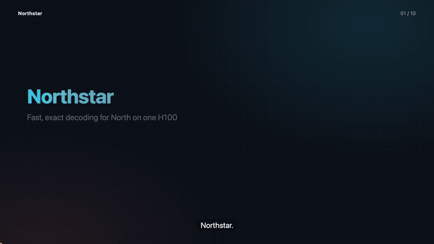
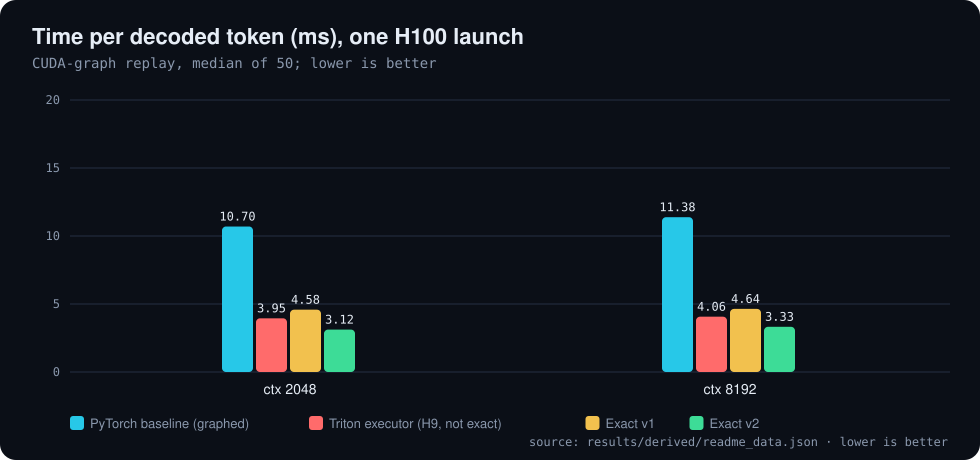
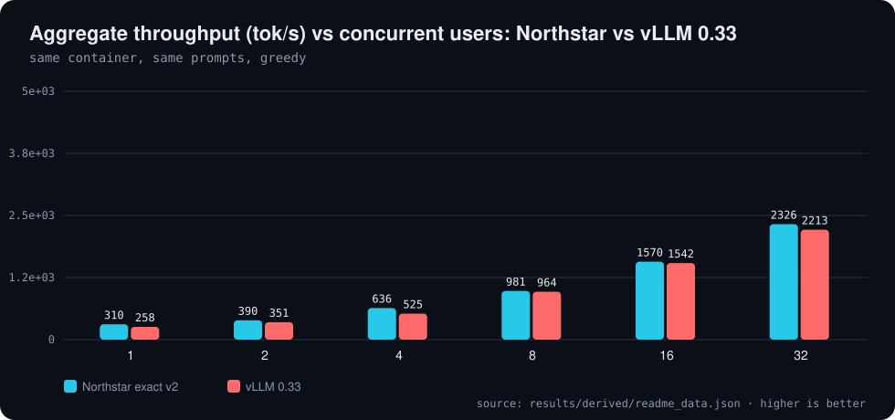
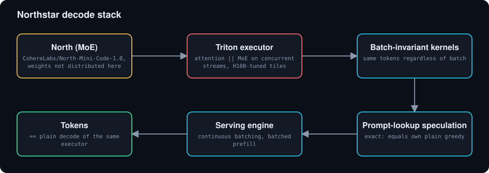
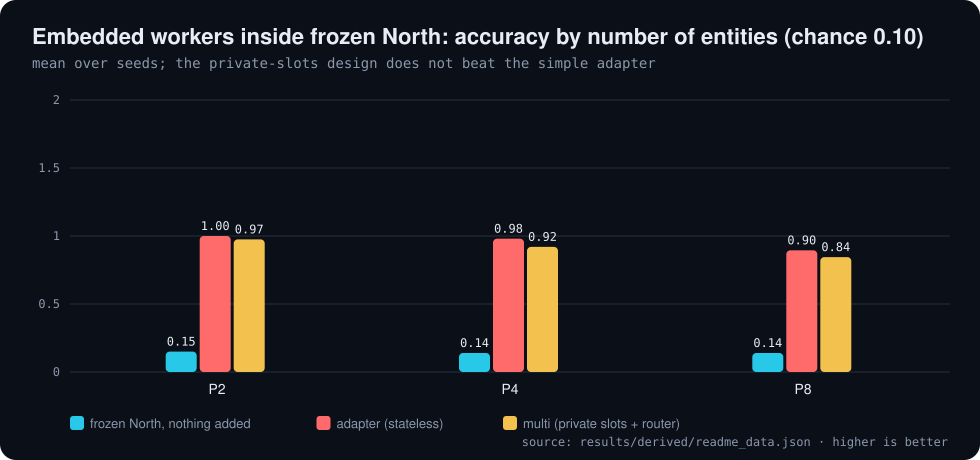

<div align="center">



# 🌟 Northstar

**Fast, exact decoding for Cohere's MoE model North on a single H100, with every number measured and logged**

[](LICENSE)     

[🎬 Video](#video) · [📊 Results](#results) · [🧩 How it works](#how-it-works) · [🏁 vs vLLM](#vs-vllm) · [🧬 North in North](#north-in-north) · [⚠️ Limits](#limits) · [🚀 Quick start](#quick-start) · [🗺️ Repo map](#repo-map)

</div>

---

**Explainer video (voice-over and subtitles): the executor, exact speculation, batching, the vLLM comparison, and where it does not help**

[](video/northstar_explainer.mp4)

<a id="video"></a>
**Fast, exact decoding for Cohere's MoE model "North" on a single H100.** A Triton decode executor plus zero-cost prompt-lookup speculation that is *lossless against its own plain decode*,
with every number measured, labeled and backed by raw logs in this repo. We also test two follow-ups: asking North to tune its own kernel, and embedding small trainable workers inside one frozen North forward pass.

<a id="results"></a>

## 📊 Results

All numbers below are MEASURED on one H100 80GB, greedy decoding, up to 192 new tokens, recomputed from `results/` by `tools/readme_data.py`. Every experiment (H1-H29) with setup, tables and caveats is in [RESULTS.md](RESULTS.md).

| Exact v2 vs graphed PyTorch | vs vLLM, 1 user | vs vLLM, 32 users | 32 users vs 1 user |
|:---:|:---:|:---:|:---:|
| **3.4x** | **1.20x** | **1.05x** | **7.5x** |

**One launch on H100, greedy: graph ms per token and live tok/s (192 tokens)**

| Context | Decoder | ms / token | vs baseline | live tok/s |
| :--- | :--- | ---: | ---: | ---: |
| ctx 2048 | PyTorch baseline (graphed) | 10.70 | 1.00x | 93 |
| ctx 2048 | Triton executor (H9, not exact) | 3.95 | 2.71x | 250 |
| ctx 2048 | Exact v1 | 4.58 | 2.34x | 219 |
| ctx 2048 | Exact v2 | 3.12 | 3.43x | 319 |
| ctx 8192 | PyTorch baseline (graphed) | 11.38 | 1.00x | 88 |
| ctx 8192 | Triton executor (H9, not exact) | 4.06 | 2.80x | 244 |
| ctx 8192 | Exact v1 | 4.64 | 2.45x | 214 |
| ctx 8192 | Exact v2 | 3.33 | 3.42x | 298 |

<sub>Source: `results/derived/readme_data.json`</sub>

<p align="center"></p>

<p align="center"></p>

<p align="center"></p>

<details>
<summary>Full results summary and the plain-English table (from the earlier README)</summary>

| Metric | Gain | Win? | Numbers |
|---|---|---|---|
| ⚡ Speed (plain decode) | **3.4x** (exact), up from 2.7x (not exact) | ✅ WIN | one launch, same H100 (H29): 10.70 → 3.12 ms per token at 2K context (93 → 319 tok/s live), 3.42x at 8K; the old non-exact executor re-measures at 2.71x and the old exact one at 2.34x |
| 🎯 Same answers | **1.00x** (no quality lost) | ✅ WIN | identical to the model's own normal decoding on every run checked: 70/70 (H14), 99/99 real prompts (H24), every serving and continuous-batching request (H26-H28) |
| 👥 Many users at once | **7.2x** total throughput | ✅ WIN | 2,219 tokens/s with 32 users together vs 308 tok/s for one user (H24 bs7; was 2,012 in H20) |
| 🏁 vs vLLM (popular tool) | **1.29x** plain, **1.49x** with speculation | ✅ WIN | same H100, same container, 99 real prompts: 321.7 / 369.8 vs 248.8 tok/s, faster on 99/99 prompts (H24; was a tie in H17) |
| 🏁 vs vLLM, many users | **1.02-1.21x** at 1-32 users | ✅ WIN (small at 8+) | same container, same 32 prompts: 2,325 vs 2,217 tok/s at 32 users, 637 vs 528 at 4 (H25) |
| 🚦 vs vLLM, requests arriving over time | **1.04-1.05x** up to 8 req/s, 0.98x at 16, **1.16x** when all arrive at once | ✅ WIN (except ~16 req/s) | continuous batching with batched prefill, same container, 64 requests; answers never depend on other requests (H27, H28) |
| 📜 Long context (8K-128K) | **1.4-2.1x** plain, **2.2x** with speculation at 128K | ✅ WIN | exact plain 90 → 187 tok/s at 128K, 211 → 322 at 32K; with the speculation index built during prefill 203 tok/s at 128K (H24, H25; was the weakest regime) |
| 🤖 North improves its own kernel | **1.056x** best, **1.026x** average | 🟡 PARTIAL | best of 3 sessions; only 1 of 3 sessions clears our 1.03x bar; 4 extra North helper copies called from outside did not change the average (1.026x with or without) |
| 🧬 North EMBEDDED inside North: workers live inside one forward pass (qwenagent-style) | **6.6x** accuracy at 4 entities (0.14 → 0.92); **6.0x** at 8 (0.14 → 0.85) | ✅ WIN (capability) / ❌ no edge over simpler adapters | a different task from the kernel test: tracking who owns what across a text. Frozen North is at chance; embedded workers get it to 0.85-0.99. The "private slots" version is 0.94x of a plain adapter (0.92 vs 0.98 at 4 entities). See H23 |

Legend: ✅ clear win · 🟡 small or partial win · ➖ tie · ❌ no win. The x is the ratio against the stated baseline (higher is better; 1.00x = no change).

### What that means
| Metric | In plain English |
|---|---|
| ⚡ Speed | Replies show up roughly 3.4x sooner. Same hardware, same model, same answers. |
| 🎯 Same answers | The speed-up is a free lunch: no quality traded away. |
| 👥 Many users at once | One GPU can serve far more people for the same cost. |
| 🏁 vs vLLM | On the same GPU we are now clearly faster than the industry standard for one user, and level-to-ahead of it with up to 32 users, with identical answers to our own normal decoding. |
| 📜 Long context | Long documents (up to 128K tokens) are now 1.4-2.1x faster too. |
| 🤖 Self-improvement | Yes, a little, and only sometimes. A human found the same size of win (+5.4-6.2%) with a simple sweep. Not a self-improvement explosion, but a real first sign. |
| 🧬 Embedded North-in-North | We really did put small trainable workers inside North's forward pass. North went from guessing to mostly right at tracking several things in a story, so embedding works. But the fancy "separate private workers" design was no better than a simple add-on, same as we saw on Qwen. Note this tests tracking ability, not making North faster. |

**Honest bottom line:** ✅ big, verified speed-ups for running North, now ahead of stock vLLM on the same H100 for one user, for static batches up to 32, and under most arrival rates we tested. ❌ no evidence yet that the model can make itself dramatically faster. Details, failures and caveats below. 👇

</details>

<details>
<summary>Detailed headline results (H9-H29)</summary>

All numbers are MEASURED on one H100 80GB, greedy decoding, up to 192 new tokens. Full tables, methods and caveats are in [`RESULTS.md`](RESULTS.md).

| Result | Number | Where |
|---|---|---|
| Plain decode, Triton executor vs graphed PyTorch baseline | 10.7 → 3.9 ms/token | H9 |
| **Same launch: baseline vs old fast (non-exact) vs old exact vs exact v2**, ctx 2K / 8K | 10.70 / 3.95 / 4.58 / **3.12 ms** (2.71x / 2.34x / **3.43x**); 8K: 11.38 / 4.06 / 4.64 / **3.33 ms** (**3.42x**) | H29 |
| Executor plus speculation vs original graphed baseline | 3.2–4.4x tok/s | H9, H10, H13 |
| Exact-mode speculation vs the same executor's plain decode | 1.18x / 1.57x / 1.34x (natural / 2K / 8K ctx) | H14 |
| Same, on 99 real prompts from 11 public datasets | 1.15x geomean (82 wins, 15 ties, 2 losses, worst 0.96x) | H15 |
| Batched exact executor, aggregate throughput | 2012 tok/s at 32 concurrent sequences | H20 |
| **Exact v2: attention and MoE branches on concurrent streams + H100-tuned tiles** (same launch, 99 real prompts) | exact plain 237 → 387 tok/s (1.63x), tokens identical to v1 on 99/99; + PLD 449 tok/s, == plain on 99/99 | H24 |
| **Exact v2 vs stock vLLM 0.33, same H100 container** | plain 321.7 vs 248.8 tok/s (1.29x), + PLD 369.8 (1.49x); faster on 99/99 prompts | H24 |
| Exact v2 at long context (same launch per ctx) | plain 8K 214 → 298, 32K 211 → 322, 128K 90 → 187 tok/s | H24 |
| Exact v2, batched | 2219 tok/s at B=32, 308 at B=1; all exactness checks 64/64 | H24 |
| Exact v2 batched vs vLLM 0.33 batched, same container | 1.20x / 1.11x / 1.21x / 1.02x / 1.02x / 1.05x at B=1/2/4/8/16/32 | H25 |
| Speculation that does not lose (cost-aware cap + index built during prefill) | mix99 1.125x, worst 0.98x; 32K 1.08x, 128K 1.08x over v2 plain, all exact | H25 |
| Serving engine (`harness/serve.py`), end to end | 1 user: mix99 368 vs 321 tok/s plain (1.146x, worst 0.974x), all paths exact; batched rows == single-user outputs at B=2..32 | H26 |
| Continuous batching (`harness/cbatch.py`) vs vLLM 0.33 under Poisson arrivals, same container | 1.04-1.08x at 2-8 req/s, 0.99x at 16, 0.91x saturated; every request == its isolated decode (64/64 at every rate) | H27 |
| Continuous batching + batch-invariant batched prefill | saturated 2,246 vs vLLM 1,941 tok/s (1.16x), still 64/64 == isolated decode at every rate | H28 |
| Stock vLLM 0.33 at batch 1 (same prompt mix, separate launches) | plain 253.5 tok/s vs ours exact plain 221.4, ours exact + speculation 254.8 (superseded by the same-container H24 comparison) | H17 |
| North improving its own kernel, closed loop (3 sessions/arm) | North alone 1.026x mean best, North + 4 North helpers called from outside 1.026x (best session 1.056x); 1 of 3 sessions pass the 1.03x gate in each | H22 |

**Exact mode** uses batch-invariant kernels, so speculative output equals the same executor's plain greedy output on 70/70 runs (and 14/14 at every tested context up to 128K). It is **not** bit-identical to Hugging Face `generate`.

</details>

**Exact mode** uses batch-invariant kernels, so speculative output equals the same executor's plain greedy output on 70/70 runs (and 14/14 at every tested context up to 128K). It is **not** bit-identical to Hugging Face `generate`.

<a id="how-it-works"></a>

## 🧩 How it works

Plain decode runs through a Triton executor that overlaps the attention and MoE branches on separate CUDA streams with H100-tuned tiles; the kernels are batch-invariant so a request's tokens never depend on its neighbours; speculation by prompt lookup (PLD) is cost-capped and its index is built during prefill.

The project started as *North improving North*: weight-stream-fused self-speculation on a persistent-kernel VM, with zero new weights, where North drafts, verifies and proposes its own optimizations. The pre-registered kill gate ([`docs/THESIS.md`](docs/THESIS.md)) was not met, and the work that held up is the executor and the exact prompt-lookup speculation above. Related work is in [`PRIOR_ART.md`](PRIOR_ART.md) and the design in [`DESIGN.md`](DESIGN.md).

Code is MIT ([`LICENSE`](LICENSE)). The prompts in `harness/workloads_real/realtraffic.jsonl` come from public datasets and keep their own licenses; see [`harness/workloads_real/LICENSES.md`](harness/workloads_real/LICENSES.md). The model weights are Cohere's and are not distributed here.

<p align="center"></p>

<a id="vs-vllm"></a>

## 🏁 Against vLLM

Same H100, same container, same prompts (H25, `results/vxb_vxb1_*`). vLLM numbers are its decode aggregate throughput.

**Batched aggregate throughput, Northstar exact v2 vs stock vLLM 0.33, same H100 container**

| Concurrent users | Northstar (tok/s) | vLLM (tok/s) | Ratio |
| ---: | ---: | ---: | ---: |
| 1 | 310 | 258 | 1.20x |
| 2 | 390 | 351 | 1.11x |
| 4 | 636 | 525 | 1.21x |
| 8 | 981 | 964 | 1.02x |
| 16 | 1,570 | 1,542 | 1.02x |
| 32 | 2,326 | 2,213 | 1.05x |

<sub>Source: `results/derived/readme_data.json`</sub>

Continuous batching under Poisson arrivals, long-context and the serving engine results are in [RESULTS.md](RESULTS.md) (H26-H28).

<a id="north-in-north"></a>

## 🧬 North in North

Small trainable worker modules inside one frozen North forward pass (H23, Modal A100-80GB, 1,500 steps, 100 eval items per cell, 2 seeds per trained mode). Capability test on a state-tracking task, not a speed test.

**North in North (H23): accuracy by number of entities, chance 0.10**

| Mode | Seeds | 2 entities | 4 | 8 |
| :--- | ---: | ---: | ---: | ---: |
| adapter (stateless) | 2 | 1.00 | 0.98 | 0.90 |
| single shared state | 2 | 1.00 | 0.96 | 0.89 |
| multi (private slots + router) | 2 | 0.97 | 0.92 | 0.84 |
| frozen North, nothing added | 1 | 0.15 | 0.14 | 0.14 |

<sub>Source: `results/derived/readme_data.json`</sub>

<p align="center"></p>

<details>
<summary>Two meanings of North inside North, and the Qwen-side related benchmarks</summary>

1. **Outside helpers (what H22 tested).** North is called several times from outside, each call with a different role prompt (planner, four specialists, selector). This is how most agent frameworks make "subagents". Result above: no gain on average.
2. **Embedded (H23, tested on North).** Small trainable worker modules live *inside* one frozen North forward pass: private recurrent state, a learned router, and a return channel into the residual stream (tapped after layer 12 of 49); no prompts, no extra calls. This is what our sister project [qwenagent](https://github.com/Bobliuuu/qwenagent) built on Qwen3-0.6B; H23 ports it to North. It was tested on a state-tracking task (ledger), **not** on the kernel-speedup task, so it says nothing yet about North making itself faster.

### H23 results: embedded workers inside frozen North (MEASURED, Modal A100-80GB, 1,500 steps, 100 eval items per cell)
Trained on 2-3 entities, tested on 2-8. Accuracy (chance is 0.10):

| Mode | seeds | P=2 | P=3 | P=4 | P=6 | P=8 | zero the return signal (P=4) |
|---|---|---|---|---|---|---|---|
| frozen North, nothing added | 1 | 0.15 | 0.14 | 0.14 | 0.10 | 0.14 | n/a |
| adapter (stateless add-on, 970k params) | 2 | 1.00 | 0.98 / 1.00 | 0.97 / 0.99 | 0.96 / 0.95 | 0.90 / 0.89 | 0.14 |
| single shared state (837k) | 2 | 1.00 | 0.98 / 0.97 | 0.95 / 0.97 | 0.93 / 0.95 | 0.85 / 0.92 | 0.14 |
| **multi: private slots + learned router (the embedded "subagents", 837k)** | 2 | 0.99 / 0.96 | 0.97 / 0.94 | 0.94 / 0.90 | 0.93 / 0.93 | 0.85 / 0.84 | 0.14 |

(two numbers = seed 0 / seed 1.) Findings: (1) Embedding works on North: frozen North is at chance (0.10-0.15) and every trained mode reaches 0.84-1.00 on up to 8 entities, even though training used 2-3. (2) The answer flows through the workers: zeroing the return signal sends every mode back to 0.14. (3) Private slots do not help: mean at P=8 is adapter 0.895, single 0.885, multi 0.845; mean at P=4 is 0.98 / 0.96 / 0.92. The router is only partly clean (purity at P=4: 0.84 seed 0, 0.54 seed 1) and the multi arm is the least stable, as in qwenagent on Qwen. (4) Long sequences (P=4, more updates per entity) are hard for all modes (0.31-0.54), same wall as in qwenagent.
Caveats: 2 seeds per trained mode, 1 for frozen; one task family; accuracy cells have about +-0.05 binomial noise at n=100; capability test only, no speed measurement. Code: modal/embedded_north_run.py, src/embedded/. Raw: results/embedded_main_20261112T144436Z.json, logs/embedded_main_vol/ (per-run logs, results, worker checkpoints). Cost about $4.3 GPU time.

These are results from the embedded approach on a different model (frozen Qwen3-0.6B up to 4B) and a different task (interleaved register / ledger tracking). They are the nearest evidence for what embedding would do, not evidence about North.

| Benchmark | Result | Win? |
|---|---|---|
| Embedding trainable workers in a frozen Qwen works at all | chance → well above chance; zeroing the return channel sends it back to chance | ✅ WIN |
| Random register names make tracking generalise (q7, 5 seeds) | trained on 2-3 registers, still well above chance at 16 | ✅ WIN |
| Private slots vs a shared state or stateless adapter (q7, q9, 5 seeds) | no advantage: 16 registers `adapter` 28.4, `single` 27.3, `multi` 25.6, `oracle` 19.6 (%) | ❌ NO WIN |
| Workers vs LoRA of about 441k parameters (q10, 5 seeds) | mean accuracy `multi` 0.410 vs LoRA 0.394 vs `adapter` 0.458 | ➖ TIE |
| Realistic ledger task (q12) | trained modes ≥0.88 at P=2-3 (frozen Qwen at chance); at P=12 `single` 0.53 vs `multi` 0.39 | 🟡 PARTIAL |
| Scale (q13) | `adapter` at P=4: 54% / 58% / 72% for 0.6B / 1.7B / 4B; `multi` falls further behind at 4B | 🟡 PARTIAL |

Takeaway: embedding extra modules inside a frozen model is feasible, but the "private subagent slots" part did not beat simpler baselines. Source: qwenagent `README.md` and `results/`.

</details>

<a id="limits"></a>

## ⚠️ Where it does not help

We report these as plainly as the wins.

- **Long context speculation needs the index off the decode path.** Speculation looked like a loss at 32K/128K (0.92x / 0.75x, H24) because the proposer indexes the whole prompt on the decode path; built during prefill it gains 1.08x (H25). Prefill is 9-12% slower in our bench while the thread runs.
- **Batching.** Prompt-lookup speculation is break-even from batch 4 up; a cost-aware cap keeps it within 1% of plain (H18–H20).
- **vs vLLM, at scale.** Against vLLM batched serving the lead is small from 8 users up (1.02-1.05x at B=8-32, H25). With requests arriving over time we are slightly slower around 16 req/s (0.98x) and vLLM has lower mean latency at 8-16 req/s, because its chunked prefill interleaves with decoding while ours pauses decoding (H27, H28). Not measured: more than 32 concurrent sequences, prompts over 1.7K tokens in the arrival tests, tuned vLLM settings. vLLM's built-in n-gram speculation is slower than its own plain on this model (0.87–0.96x) (H17).
- **Batching gains shrink.** The concurrent-branch trick gives 1.4x at 1 user but only 1.10-1.15x at 32: large batches are limited by reading expert weights, not by running branches one after another (H24).
- **Self-speculation, the original thesis.** The model drafting for itself, fused with verification, never beat plain decode on any executor, context (up to 128K) or batch size tested (H5–H8, H11, H12).
- **Self-improvement, open loop (H21, H21b).** Proposing without measured feedback, North authored no gate-passing optimization: its best edit set was 1.003-1.009x against 1.054-1.062x for the human sweep, indistinguishable from budget-matched random search (1 passing set in 66 draws) and from general-purpose models given the same prompt (0 passing sets in 99 samples). See [`docs/SELFIMPROVE_ANALYSIS.md`](docs/SELFIMPROVE_ANALYSIS.md).
- **Self-improvement, closed loop, with North helpers called from outside (H22).** With measured speedups fed back each round (8 rounds x 3 builds, 3 sessions per arm), a single North finds a gate-passing config in 1 of 3 sessions (best 1.041x). A North orchestrator calling four North helper copies through prompts (only North, no other model; this is NOT the embedded version) also passes in 1 of 3 sessions (best 1.056x, the only arm that found the human sweep's KC=64 move). Mean best is identical (1.026x), so the subagents did not help on average at n=3; a standard autotuner at the same budget got 1.002x. Feedback timings are noisy (about 4%), which affects every arm. See H22 in [`RESULTS.md`](RESULTS.md).


<details>
<summary>Scope and caveats</summary>

Terms: **PLD** is prompt-lookup decoding (drafting tokens by copying matching spans from the prompt); **exact mode** means speculative output equals the same executor's plain greedy output.

One model (`CohereLabs/North-Mini-Code-1.0`, pinned revision), one GPU type for the headline numbers (H100; some kernel sweeps on A100-80GB), greedy decoding only, no sampling path. Single launches per configuration; absolute tok/s moves by up to about 10% between hosts, so compare ratios inside one launch first. Every claim in `RESULTS.md` is tagged MEASURED, INFERRED or SIMULATED. The self-improvement comparison ran only OpenAI models as external proposers; Anthropic, Google and other models were not tested.

</details>

<a id="quick-start"></a>

## 🚀 Quick start

```bash
make setup     # venv with the pinned versions from SETUP.md
make test      # all CPU unit tests
make check     # correctness: speculative == plain greedy, fused == two-pass reference
make plots     # regenerate plots from raw results/
make bench     # PRINTS the Modal commands for GPU runs (costs money; does not run them)
```

Serving with the measured configuration (exact v2, speculation only where it never lost; needs an H100 and the weights, H26):

```python
from serve import Engine                       # harness/serve.py
eng = Engine(model, Lmax=4096)                 # captures graphs + cost tables once
outs, stats = eng.generate([ids_a, ids_b], max_new=192)   # == plain greedy of the same executor, token for token

from cbatch import ContinuousEngine, Request   # harness/cbatch.py: requests join/leave between decode steps (H27, H28)
ce = ContinuousEngine(model, Lmax=4096, slots=32)
reqs = [Request(i, ids, max_new=192, arrival=t) for i, (ids, t) in enumerate(arrivals)]
stats = ce.run(reqs)                           # each request's tokens == the same request decoded alone
```

GPU runs go through [Modal](https://modal.com) and are launched with `modal run --detach`; see [`SETUP.md`](SETUP.md) for pins and [`RUNS.md`](RUNS.md) for the run ledger.

<a id="repo-map"></a>

## 🗺️ Repo map

| Path | What is in it |
|---|---|
| `harness/` | Serving engine (`serve.py`), continuous batching (`cbatch.py`), Triton executors (`fast_north.py`, `fast_kernels*.py`; exact v2 = `FastNorth.set_x2(**fast_kernels_x2.recommended(Lmax))`), batched exact executor, PLD / suffix proposers, benchmarks |
| `modal/` | Modal entry points for every GPU experiment |
| `src/` | Subprojects: `northstar` reference model, `kvm` fused-MoE kernels, `approx`, `opt`, `selfedit`, `adapt_sched`, `async_spec`, `mk_selfspec` |
| `tests/` | CPU unit tests for the core package |
| `results/` | Raw JSONL / JSON results and plots, one file per run |
| `logs/` | Client-side run logs |
| `docs/` | Design notes: [`THESIS.md`](docs/THESIS.md), [`PLAN.md`](docs/PLAN.md), [`NORTH_ARCH.md`](docs/NORTH_ARCH.md), self-improvement and kernel notes |
| `RESULTS.md` | Every experiment (H1–H28): setup, tables, findings, caveats |
| `NEXT_STEPS.md` | Current status and the next experiments |

---

<div align="center"><sub>Generated with [video-readme-maker](https://github.com/Bobliuuu/video-readme-maker).</sub></div>
