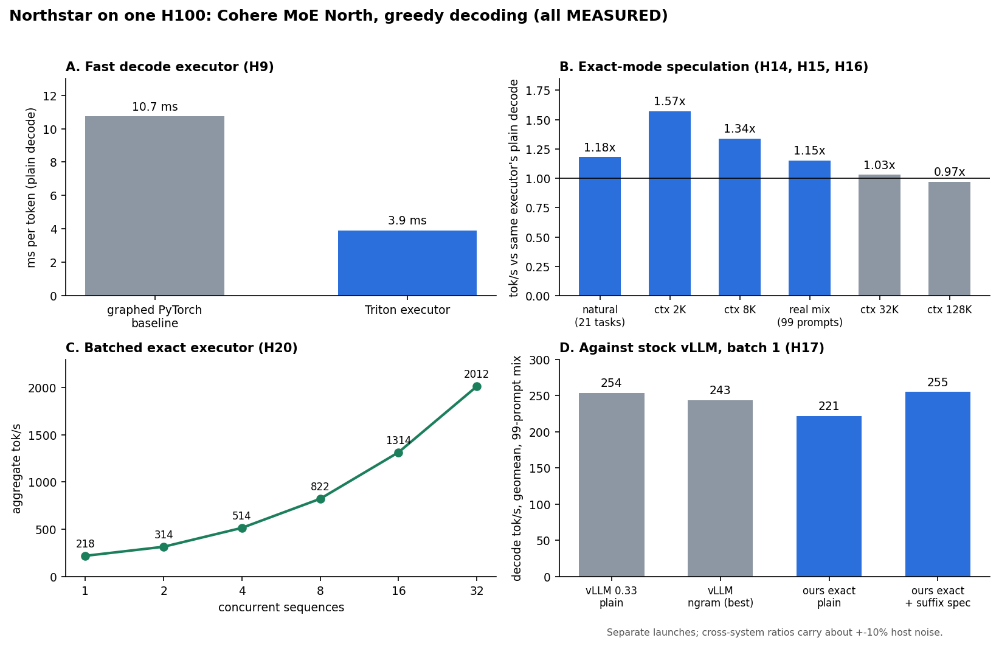
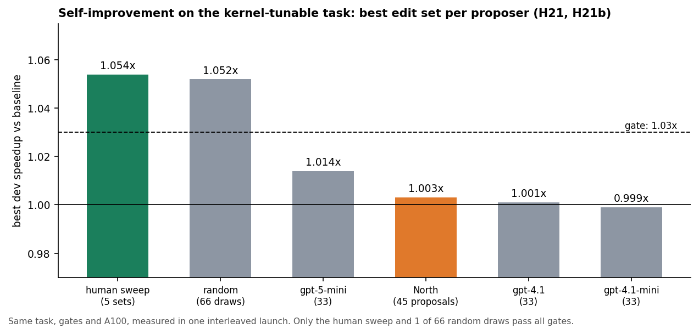
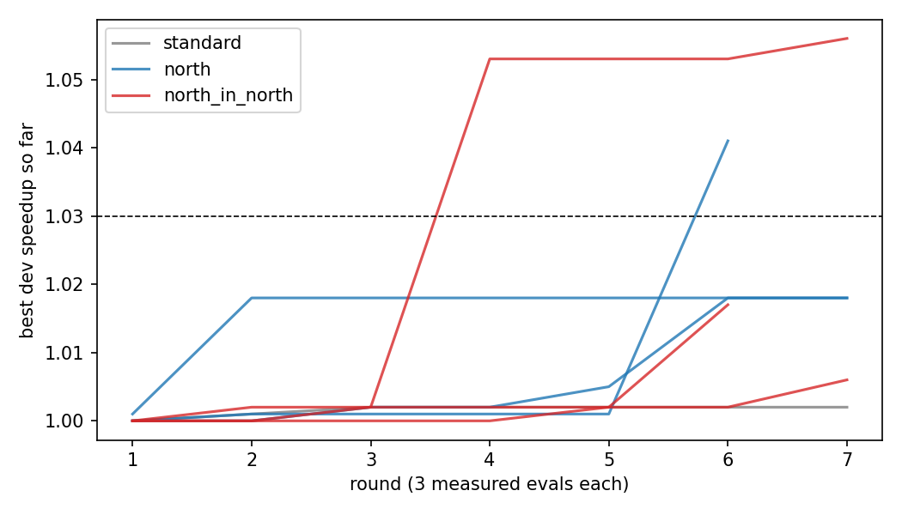

<h1 align="center">🌟 Northstar 🌟</h1>

<div align="center">

      

</div>

**Fast, exact decoding for Cohere's MoE model "North" on a single H100.**
A Triton decode executor plus zero-cost prompt-lookup speculation that is *lossless against its own plain decode*, with every number measured, labeled and backed by raw logs in this repo.

## 🏆 HEADLINE: how far did we push it, and what does it mean?

**In plain English:** we made the AI model **about 3x faster at writing text**, with **the same words coming out as its own normal decoding**, on one GPU. Then we asked the model to speed *itself* up. It **barely managed it (about 5%)**, so for now humans are still better at tuning it.

### 📈 What we got

| Metric | Gain | Win? | Numbers |
|---|---|---|---|
| ⚡ Speed (plain decode) | **2.7x** | ✅ WIN | 10.7 → 3.9 ms per token; **3.2-4.4x** with speculation vs the original setup |
| 🎯 Same answers | **1.00x** (no quality lost) | ✅ WIN | identical to the model's own normal decoding on 70/70 runs |
| 👥 Many users at once | **9.1x** total throughput | ✅ WIN | 2,012 tokens/s with 32 users together vs 221 tok/s for one user (derived ratio) |
| 🏁 vs vLLM (popular tool) | **1.01x** | ➖ TIE | 254.8 vs 253.5 tok/s, one user |
| 🤖 North improves its own kernel | **1.056x** best, **1.026x** average | 🟡 PARTIAL | best of 3 sessions; only 1 of 3 sessions clears our 1.03x bar |
| 👯 North inside North vs one North | **1.00x** | ❌ NO WIN | same average (1.026x) for both; one lucky session |

Legend: ✅ clear win · 🟡 small or partial win · ➖ tie · ❌ no win. The x is the ratio against the stated baseline (higher is better; 1.00x = no change).

### 💡 What that means

| Metric | In plain English |
|---|---|
| ⚡ Speed | Replies show up roughly 3x sooner. Same hardware, same model. |
| 🎯 Same answers | The speed-up is a free lunch: no quality traded away. |
| 👥 Many users at once | One GPU can serve far more people for the same cost. |
| 🏁 vs vLLM | We match the industry standard; we do not beat it. |
| 🤖 Self-improvement | Yes, a little, and only sometimes. A human found the same size of win (+5.4-6.2%) with a simple sweep. Not a self-improvement explosion, but a real first sign. |
| 👯 North inside North | Extra copies did not make it smarter on average; they just found one lucky win. |

**Honest bottom line:** ✅ big, verified speed-ups for running North. ❌ no evidence yet that the model can make itself dramatically faster. Details, failures and caveats below. 👇



## 📊 Detailed headline results

All numbers are MEASURED on one H100 80GB, greedy decoding, up to 192 new tokens. Full tables, methods and caveats are in [`RESULTS.md`](RESULTS.md).

| Result | Number | Where |
|---|---|---|
| Plain decode, Triton executor vs graphed PyTorch baseline | 10.7 → 3.9 ms/token | H9 |
| Executor plus speculation vs original graphed baseline | 3.2–4.4x tok/s | H9, H10, H13 |
| Exact-mode speculation vs the same executor's plain decode | 1.18x / 1.57x / 1.34x (natural / 2K / 8K ctx) | H14 |
| Same, on 99 real prompts from 11 public datasets | 1.15x geomean (82 wins, 15 ties, 2 losses, worst 0.96x) | H15 |
| Batched exact executor, aggregate throughput | 2012 tok/s at 32 concurrent sequences | H20 |
| Stock vLLM 0.33 at batch 1 (same prompt mix) | plain 253.5 tok/s vs ours exact plain 221.4, ours exact + speculation 254.8 | H17 |
| North improving its own kernel, closed loop (3 sessions/arm) | North alone 1.026x mean best, North + 4 North subagents 1.026x (best session 1.056x); 1 of 3 sessions pass the 1.03x gate in each | H22 |

**Exact mode** uses batch-invariant kernels, so speculative output equals the same executor's plain greedy output on 70/70 runs (and 14/14 at every tested context up to 128K). It is **not** bit-identical to Hugging Face `generate`.

## ⚠️ Where it does not help

We report these as plainly as the wins.

- **Long context.** Exact-mode speculation gains vanish at 32K (1.03x) and 128K (0.97x), and the exact executor's plain step is slower than the non-exact one there (H16).
- **Batching.** Prompt-lookup speculation is break-even from batch 4 up; a cost-aware cap keeps it within 1% of plain (H18–H20).
- **vs vLLM.** On the real-prompt mix our exact decode is about level with stock vLLM plain, not ahead of it. vLLM's built-in n-gram speculation is slower than its own plain on this model (0.87–0.96x) (H17).
- **Self-speculation, the original thesis.** The model drafting for itself, fused with verification, never beat plain decode on any executor, context (up to 128K) or batch size tested (H5–H8, H11, H12).
- **Self-improvement, open loop (H21, H21b).** Proposing without measured feedback, North authored no gate-passing optimization: its best edit set was 1.003-1.009x against 1.054-1.062x for the human sweep, indistinguishable from budget-matched random search (1 passing set in 66 draws) and from general-purpose models given the same prompt (0 passing sets in 99 samples). See [`docs/SELFIMPROVE_ANALYSIS.md`](docs/SELFIMPROVE_ANALYSIS.md).
- **Self-improvement, closed loop, and North inside North (H22).** With measured speedups fed back each round (8 rounds x 3 builds, 3 sessions per arm), a single North finds a gate-passing config in 1 of 3 sessions (best 1.041x). A North orchestrator driving four North subagents (only North, no other model) also passes in 1 of 3 sessions (best 1.056x, the only arm that found the human sweep's KC=64 move). Mean best is identical (1.026x), so the subagents did not help on average at n=3; a standard autotuner at the same budget got 1.002x. Feedback timings are noisy (about 4%), which affects every arm. See H22 in [`RESULTS.md`](RESULTS.md).





## 🔍 Scope and caveats

Terms: **PLD** is prompt-lookup decoding (drafting tokens by copying matching spans from the prompt); **exact mode** means speculative output equals the same executor's plain greedy output.


One model (`CohereLabs/North-Mini-Code-1.0`, pinned revision), one GPU type for the headline numbers (H100; some kernel sweeps on A100-80GB), greedy decoding only, no sampling path. Single launches per configuration; absolute tok/s moves by up to about 10% between hosts, so compare ratios inside one launch first. Every claim in `RESULTS.md` is tagged MEASURED, INFERRED or SIMULATED. The self-improvement comparison ran only OpenAI models as external proposers; Anthropic, Google and other models were not tested.

## 🚀 Quick start (CPU only, no GPU or weights needed)

```bash
make setup     # venv with the pinned versions from SETUP.md
make test      # all CPU unit tests
make check     # correctness: speculative == plain greedy, fused == two-pass reference
make plots     # regenerate plots from raw results/
make bench     # PRINTS the Modal commands for GPU runs (costs money; does not run them)
```

GPU runs go through [Modal](https://modal.com) and are launched with `modal run --detach`; see [`SETUP.md`](SETUP.md) for pins and [`RUNS.md`](RUNS.md) for the run ledger.

## 🗺️ Repository map

| Path | What is in it |
|---|---|
| `harness/` | Triton executors (`fast_north.py`, `fast_kernels*.py`), batched exact executor, PLD / suffix proposers, benchmarks |
| `modal/` | Modal entry points for every GPU experiment |
| `src/` | Subprojects: `northstar` reference model, `kvm` fused-MoE kernels, `approx`, `opt`, `selfedit`, `adapt_sched`, `async_spec`, `mk_selfspec` |
| `tests/` | CPU unit tests for the core package |
| `results/` | Raw JSONL / JSON results and plots, one file per run |
| `logs/` | Client-side run logs |
| `docs/` | Design notes: [`THESIS.md`](docs/THESIS.md), [`PLAN.md`](docs/PLAN.md), [`NORTH_ARCH.md`](docs/NORTH_ARCH.md), self-improvement and kernel notes |
| `RESULTS.md` | Every experiment (H1–H20): setup, tables, findings, caveats |
| `NEXT_STEPS.md` | Current status and the next experiments |

## Background

The project started as *North improving North*: weight-stream-fused self-speculation on a persistent-kernel VM, with zero new weights, where North drafts, verifies and proposes its own optimizations. The pre-registered kill gate ([`docs/THESIS.md`](docs/THESIS.md)) was not met, and the work that held up is the executor and the exact prompt-lookup speculation above. Related work is in [`PRIOR_ART.md`](PRIOR_ART.md) and the design in [`DESIGN.md`](DESIGN.md).

## License

Code is MIT ([`LICENSE`](LICENSE)). The prompts in `harness/workloads_real/realtraffic.jsonl` come from public datasets and keep their own licenses; see [`harness/workloads_real/LICENSES.md`](harness/workloads_real/LICENSES.md). The model weights are Cohere's and are not distributed here.
